<p align="center">
  
</p>

<p align="center">
  
  
  
  
</p>

<p align="center">
  <b><a href="https://maristelaoliveira.github.io/adm-recursos/">🌐 Abrir o site da disciplina</a></b>
  &nbsp;·&nbsp;
  <b><a href="https://maristelaoliveira.github.io/adm-recursos/#aulas">📚 Ir direto para as aulas</a></b>
  &nbsp;·&nbsp;
  <b><a href="https://maristelaoliveira.github.io/adm-recursos/#avaliacao">📊 Ver a avaliação</a></b>
</p>

---

## `$ whoami`

Prazer, eu sou a **Profa. Maristela**, ou só **Stela**! 👋

Boas-vindas à **Administração de Recursos Computacionais (ARC)**, do curso de **Gestão da Tecnologia da Informação** da Faculdade de Tecnologia e Inovação Senac DF (4º semestre, matutino, 70 horas: 60 presenciais e 10 a distância).

Este repositório é o **site da disciplina**: o lugar onde ficam as aulas, os estudos de caso, os laboratórios e tudo o que a gente usa no semestre. Nada de slides: aqui a aula é o próprio site.

A ideia é simples. Quando a TI vai bem, ninguém lembra que ela existe. Neste semestre a gente monta e administra essa infraestrutura, uma camada por vez.

```text
stela@arc:~$ uptime
 08:00  up 18 aulas,  1 turma,  load average: café, café, café

stela@arc:~$ id filhotes
uid=1000(filhotes) grupos=gti,sudo

stela@arc:~$ sudo apt install curiosidade
Lendo listas de pacotes... Pronto
curiosidade já é a versão mais recente. ✅
```

> 💡 Toda boa história de suporte começa com a mesma pergunta: **"já tentou desligar e ligar de novo?"** Neste semestre você vai descobrir por que, às vezes, isso funciona. E por que, às vezes, não. 😉

---

## 🧭 O que tem no site

| | Seção | Para que serve |
|:-:|---|---|
| 🔬 | **Raio-X da infraestrutura** | O que tem por trás de um clique: rede, pessoas, serviços e gestão. Com casos reais, como o apagão de DNS do Facebook (2021) e a Maersk salva por um servidor em Gana (2017). |
| 📜 | **Ementa e objetivos** | A ementa oficial, palavra por palavra, e aonde a gente quer chegar. |
| 🧩 | **Conteúdo programático** | As quatro unidades do semestre. Cada uma acrescenta uma camada. |
| 📚 | **Aulas** | Uma página por encontro, com conceitos, estudo de caso, atividade, conexão STEAM, materiais e entrega. |
| ✅ | **Checklist da atividade** | Você marca o que já fez. Fica salvo no seu navegador, com barra de progresso. |
| 🛠️ | **Metodologia e ferramentas** | Simulador, máquina virtual e olhar de gestor. |
| 📊 | **Avaliação** | Como a nota é montada nos dois bimestres. |
| 🔗 | **Atividades e materiais** | NetAcad, Packet Tracer e a documentação oficial do Linux e do Windows. |
| 📖 | **Bibliografia** | Os livros da básica e da complementar, vários na Biblioteca Digital. |

Todas as páginas têm **tema claro e escuro**, **aumento de texto** (`A+`) e botão para **pausar as animações**.

---

## 🗺️ A trilha do semestre

Quatro unidades, uma infraestrutura. No fim, elas viram o projeto final. Em "sysadminês", fica assim:

```text
stela@arc:~$ systemctl list-units --type=unidade
UNIT                         AULAS     DESCRIPTION
U1-rede.service              2 a 5     Redes, cliente e servidor: cada um no seu endereço
U2-usuarios.service          6 e 7     Usuários, perfis e políticas: quem pode o quê
U3-email-diretorio.service   10 a 13   Correio eletrônico e LDAP: uma conta, todos os sistemas
U4-gestao.service            14 e 15   SNMP, monitoramento e Samba: juntar os mundos

4 units listed. projeto-final.target: waiting for you 🚀
```

| Aula | Tema | |
|:-:|---|:-:|
| 01 | Conhecendo a disciplina e os recursos de uma infraestrutura de TI | [abrir](https://maristelaoliveira.github.io/adm-recursos/aulas/aula-01.html) |
| 02 | Cliente e servidor: como os computadores conversam? | [abrir](https://maristelaoliveira.github.io/adm-recursos/aulas/aula-02.html) |
| 03 | Configurando interfaces de rede, parte 1 | [abrir](https://maristelaoliveira.github.io/adm-recursos/aulas/aula-03.html) |
| 04 | Configurando interfaces de rede, parte 2: Linux | [abrir](https://maristelaoliveira.github.io/adm-recursos/aulas/aula-04.html) |
| 05 | Serviços de rede: DHCP e DNS | [abrir](https://maristelaoliveira.github.io/adm-recursos/aulas/aula-05.html) |
| 06 | Administração de usuários e grupos | [abrir](https://maristelaoliveira.github.io/adm-recursos/aulas/aula-06.html) |
| 07 | Perfis de usuários e políticas de acesso | [abrir](https://maristelaoliveira.github.io/adm-recursos/aulas/aula-07.html) |
| 08 | Revisão e atividade avaliativa prática do 1º bimestre | [abrir](https://maristelaoliveira.github.io/adm-recursos/aulas/aula-08.html) |
| 09 | Avaliação do 1º bimestre | [abrir](https://maristelaoliveira.github.io/adm-recursos/aulas/aula-09.html) |
| 10 | Como um e-mail chega ao destino? | [abrir](https://maristelaoliveira.github.io/adm-recursos/aulas/aula-10.html) |
| 11 | Serviço de correio eletrônico no Linux | [abrir](https://maristelaoliveira.github.io/adm-recursos/aulas/aula-11.html) |
| 12 | Serviço de diretórios: o que é LDAP? | [abrir](https://maristelaoliveira.github.io/adm-recursos/aulas/aula-12.html) |
| 13 | Implantando o OpenLDAP | [abrir](https://maristelaoliveira.github.io/adm-recursos/aulas/aula-13.html) |
| 14 | Protocolos de gerenciamento e monitoramento na prática | [abrir](https://maristelaoliveira.github.io/adm-recursos/aulas/aula-14.html) |
| 15 | Integração Linux e Windows e projeto de infraestrutura | [abrir](https://maristelaoliveira.github.io/adm-recursos/aulas/aula-15.html) |
| 16 a 18 | Ajustes finais e ensaio, apresentação do projeto final e avaliação final de recuperação | em breve |

> 🏁 **Projeto final:** cada grupo entrega a infraestrutura inteira de uma pequena organização, funcionando e documentada no GitHub: rede, usuários e políticas, e-mail, diretório, monitoramento e integração Linux e Windows.

---

## 🧪 Como é uma aula

Cada aula começa com um problema e uma explicação curta, e segue para o laboratório. Toda aula tem um **estudo de caso**: incidentes reais, com fonte, ou organizações fictícias (e aí está escrito que é fictício).

```text
[    0.000] problema: "metade da rede ficou sem internet. por quê?"
[    0.420] conceitos: DHCP, DNS, endereço, máscara, gateway
[    1.337] estudo de caso: o que deu errado, e como evitar
[    2.718] laboratório: Packet Tracer e máquina virtual
[    3.141] checklist: "Configurei...", "Testei...", "Entreguei..."
[    4.000] boot completo. o aluno está pronto para a próxima aula ✅
```

Curto-circuito? **Lê o log**: ele conta o que aconteceu, na ordem. 🔍

---

## 🛠️ Ferramentas da disciplina

<p align="center">
  
</p>

<p align="center">
  
  
  
  
  
  
</p>

| Ferramenta | Para quê |
|---|---|
| 🌐 **Cisco Packet Tracer** | O simulador dos laboratórios, para enxergar a rede. Gratuito com a conta da NetAcad. |
| 🐧 **Linux** (Ubuntu Server) | Configurar de verdade: interfaces, usuários, e-mail, OpenLDAP, SNMP e Samba. |
| 🪟 **Windows** e **Microsoft Learn** | O lado Windows: Active Directory, Entra ID e políticas de grupo. |
| 📦 **VirtualBox** | As máquinas virtuais Linux e Windows, sem medo de quebrar nada. |
| 🎓 **NetAcad · Fundamentos de Redes** | A trilha a distância da disciplina, com checkpoints, laboratórios e certificado. |
|  **GitHub** | A documentação do projeto final. |
| 📝 **Moodle** | Onde você entrega os roteiros de laboratório. |
| 💬 **Teams, Loop e Whiteboard** | Combinar, tirar dúvida e trabalhar junto. |

---

## 🤖 IA com consciência

A IA ajuda a explicar arquivos de configuração, criar scripts e investigar problemas. Mas tudo o que ela sugerir é **testado no laboratório** antes de valer. E tem **dia sem IA**: em algumas atividades, Copilot e companhia ficam desligados, para você ver o quanto já anda sozinho. 💪

```text
stela@arc:~$ copilot "o que faz esta linha do netplan?"
✔ explicação recebida
stela@arc:~$ sudo netplan try
✔ testei antes de confiar. é assim que se faz.
```

---

## 📊 Como a nota é montada

| 1º bimestre (10 pontos) | | 2º bimestre (10 pontos) | |
|---|:-:|---|:-:|
| Prova objetiva | 6,0 | Apresentação do projeto final | 7,0 |
| Atividade avaliativa prática | 4,0 | Avaliação Integrada | 2,0 |
| | | Participação na Jornada Interdisciplinar | 1,0 |

Para ser aprovado: **média final 6,0** e pelo menos **75% de frequência**.

```text
[  FAILED  ] Failed to start aprovacao.service
             Motivo: frequência abaixo de 75%
```

> Esse erro a gente não quer ver no seu boot. Venha às aulas! 😉

---

## 🙋 Dicas de sobrevivência

1. **Leia o log antes de pedir socorro.** Ele quase sempre diz o que aconteceu, e em que ordem.
2. **Anote o que mudou.** Configuração sem anotação é mistério para o você de amanhã.
3. **Use a máquina virtual sem medo.** É para isso que ela existe: o que quebra lá dentro não quebra o seu computador.
4. **Menor privilégio sempre.** O `root` fica guardado; o dia a dia é com `sudo`.
5. **Teste de propósito.** Desligue o serviço, erre o IP, troque a senha. Veja o que quebra.
6. **Travou?** Pergunte no Teams. Ninguém nasce sabendo `systemctl`.

---

<details>
<summary><b>👩‍🏫 Para a professora (estrutura do repositório)</b></summary>

<br>

Site estático publicado no GitHub Pages a partir da branch `main`, sem build e sem dependências.

```text
adm-recursos/
├── index.html            # página da disciplina (raio-x, ementa, unidades, aulas, avaliação, materiais)
├── aulas/
│   └── aula-NN.html      # uma página por aula: conceitos, caso, atividade, STEAM, materiais, entrega
└── assets/
    ├── css/              # estilo.css e neon.css (visual comum dos sites da Stela), disciplina.css e aula.css
    ├── js/               # placa.js e matrix.js (visual comum) e aulas.js (checklist e lista de aulas)
    └── img/              # ícones, logo, ícones das tecnologias (tec/) e o banner deste README
```

- **Textos da página da disciplina:** procure os comentários `EDITE AQUI` no `index.html`.
- **Aula nova:** copie uma `aulas/aula-NN.html`, troque o conteúdo e coloque o link no título da aula, na lista do `index.html` (uma linha por aula, numerada e sem data).
- **Checklist:** cada `<ol class="checklist" id="...">` precisa de um `id` próprio; o `aulas.js` guarda o que o aluno marcou no navegador dele.
- **Visual comum:** `estilo.css`, `neon.css`, `placa.js` e `matrix.js` são iguais aos dos outros sites. Não edite aqui.
- **Antes de publicar:** testar no navegador, também na largura de celular (390 px).

</details>

---

<p align="center">
  Feito com ♥ e sucata eletrônica pela <a href="https://maristelaoliveira.github.io/">Profa. Maristela</a> · Faculdade de Tecnologia e Inovação Senac DF
  <br>
  <code>sudo apt install curiosidade</code>
</p>
